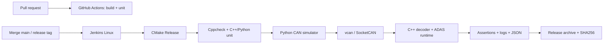

# ADAS Integration Lab

Đồ án C++17/Python mô phỏng ECU nhận CAN, giải mã DBC, tính Time To Collision (TTC), phát cảnh báo và kiểm chứng bằng CI/CT trên Linux.



## Chuẩn bị

Ubuntu Linux, CMake >= 3.16, C++17, GoogleTest, Python >= 3.10, cppcheck; kernel hỗ trợ `vcan`. Chỉ bước provision interface cần sudo, ứng dụng và tests chạy bằng user thường.

```bash
bash scripts/setup_ubuntu.sh
python3 -m venv .venv
.venv/bin/python -m pip install -r requirements.txt
bash scripts/setup_vcan.sh
```

## Build và chạy

```bash
.venv/bin/python scripts/build.py --build-type Release --build-dir build-release
./build-release/adas_app 50 100 0
./build-release/adas_app 80 20 7
./build-release/adas_app 80 10 10
```

Output lần lượt `WarningLevel=NONE`, `WARNING`, `CRITICAL`. Với closing speed dương: `TTC = distance / closing_speed`; TTC <= 2 s là CRITICAL, <= 4 s là WARNING, lớn hơn là NONE. Closing speed <= 0 và distance > 0 là NONE; distance = 0 là CRITICAL. Các giá trị phải hữu hạn, speed thuộc [0,300], distance không âm. CLI sai hoặc input không hợp lệ trả 2, lỗi hệ thống trả 1, hoàn thành/dừng signal bình thường trả 0.

Hai terminal để chạy end-to-end:

```bash
# Terminal 1
./build-release/adas_app --adas vcan0
# Hoặc dùng cấu hình runtime:
./build-release/adas_app --adas vcan0 --config config/adas.yaml
```

```bash
# Terminal 2
.venv/bin/python scripts/simulate_can.py --scenario warning
```

`--can vcan0` in raw frames; `--decode vcan0` in tín hiệu đã giải mã. `--adas` ghép state vehicle/radar mới nhất, phát `ADAS_READY` rồi `ADAS_STATE` khi state thay đổi. Watchdog mặc định 500 ms cho cả vehicle và radar; radar timeout được ưu tiên. Radar `ObjectValid=0` vẫn refresh watchdog, trả NONE/NO_OBJECT. Frame sai DLC/range làm nguồn tương ứng invalid cho tới khi được thay bằng frame hợp lệ. SIGINT/SIGTERM dọn socket và dừng bình thường.

`config/adas.yaml` là YAML phẳng giới hạn ở bốn khóa số: `critical_ttc_s`, `warning_ttc_s`, `radar_timeout_ms`, `vehicle_timeout_ms`. Dùng `--config` để nạp; thiếu cờ thì dùng mặc định. Khóa lạ/trùng, số không hữu hạn, timeout không dương hoặc ngưỡng sai thứ tự bị từ chối trước khi mở CAN. Không hỗ trợ YAML lồng nhau, anchors hoặc các kiểu dữ liệu khác.

## CAN và DBC

| Message | ID | Tín hiệu |
| --- | --- | --- |
| VehicleState | 0x100 | VehicleSpeed km/h, SteeringAngle deg, BrakeStatus |
| RadarObject | 0x200 | ObjectDistance m, RelativeVelocity m/s, ObjectValid |

[`dbc/vehicle.dbc`](dbc/vehicle.dbc) định nghĩa Classical CAN standard, payload 8 byte, little-endian. RelativeVelocity dương nghĩa là tiến gần; không trừ vehicle speed thêm lần nữa. Simulator kiểm tra DBC contract trước khi gửi. `invalid_signal` chủ ý encode VehicleSpeed=301; traffic bình thường dùng strict validation.

```bash
cansend vcan0 100#200383FF01000000
cansend vcan0 200#C800BC0201000000
candump vcan0
```

## Kiểm thử và fault injection

```bash
.venv/bin/python scripts/run_tests.py --suite unit --build-dir build-release
.venv/bin/python scripts/static_analysis.py
.venv/bin/python scripts/run_tests.py --suite integration --build-dir build-release
PYTHON=.venv/bin/python bash scripts/regression_test.sh --suite full
```

Unit suite gồm GoogleTest/CTest và Python contracts, không cần vcan. Integration chạy tuần tự trên cùng bus; dành riêng interface cho một run, không bật simulator thủ công cùng lúc. Thiếu dependency/interface là lỗi, không tự skip. Có thể chọn một hoặc nhiều `--scenario NAME`.

| Scenario | Hành vi phải quan sát |
| --- | --- |
| normal | App OK/NONE |
| warning | App OK/WARNING, TTC=20/7 s |
| critical | App OK/CRITICAL, TTC=1 s |
| radar_timeout | Warmup hợp lệ, radar im lặng, vehicle tiếp tục, timeout >=500 ms |
| invalid_signal | INVALID_INPUT/OUT_OF_RANGE nguồn VehicleState |
| invalid_can_id | Unknown ID xen kẽ traffic hợp lệ, giữ OK/NONE |
| wrong_dlc | Radar DLC=7, INVALID_INPUT/WRONG_DLC và diagnostic |
| high_frequency | Traffic chu kỳ 1 ms, ít nhất 1000 frames, giữ OK/WARNING |
| invalid_configuration | Simulator từ chối period sai với exit 2; app còn sống và timeout |

Scenario lỗi đạt khi app/simulator xử lý lỗi đúng hợp đồng; fault không nhất thiết làm test thất bại. Khi app xử lý sai, test runner trả nonzero để CI đỏ. High frequency chỉ kiểm tra tải mô phỏng, không chứng minh deadline thời gian thực hoặc không mất frame.

Mỗi invocation lưu thư mục riêng trong `<build-dir>/reports/`: `summary.json`, stdout/stderr của CTest/Python, app và simulator, cùng scenario summary. Runner dừng/reap các process do chính nó tạo cả khi fail/interrupt. Cppcheck gate bật warning/performance và fail khi có finding hoặc tool error. `--clean` chỉ xóa build directory có cache thuộc repo này hoặc thư mục mới.

## Monitoring, release và bisect

```bash
.venv/bin/python scripts/collect_system_info.py --build-dir build-release \
  --output build-release/reports/system_info.json
.venv/bin/python scripts/package_artifact.py --build-dir build-release \
  --output-dir build-release/package --build-number local-1
.venv/bin/python scripts/demo_bisect.py
```

Collector ghi snapshot có thời điểm UTC, CPU/RAM/disk/load, kernel, Python, CMake, compiler và Git SHA; metric không khả dụng có giá trị null. Đây là build diagnostics tại một thời điểm.

Trước khi package, commit source và configure/build Release lại. CMake ghi `build_metadata.txt`; packager kiểm tra source sạch, SHA hiện tại khớp SHA lúc configure, compiler/build type và executable. Archive chứa `release/bin/adas_app`, `release/config/adas.yaml`, `release/dbc/vehicle.dbc`, `release/version.txt`; checksum dùng tên file tương đối. Helper từ chối ghi đè, kiểm tra layout, byte binary, checksum và chạy smoke test binary sau giải nén. Chỉ dùng trên Linux có kiến trúc/runtime tương thích.

Exact tag, ví dụ `v1.0.0`, tạo `adas-app-v1.0.0.tar.gz`; build không tag dùng SHA và build number. Tag/release trên remote cần thực hiện theo workflow trong [runbook](docs/CI_RUNBOOK.md). Metadata truy vết source/toolchain; chạy lại configure/build sau mỗi thay đổi source, không sửa binary thủ công.

Demo bisect dựng lịch sử Git tạm gồm good, thay đổi vô hại và sửa sai ngưỡng TTC; chạy regression gate thật, kiểm tra good=0/bad=1, bisect đúng commit, reset và xóa repo tạm. Evidence nằm trong `build-bisect-demo/reports/`. Lịch sử làm việc hiện tại được giữ nguyên.

## CI/CT

GitHub Actions chạy `quick-ci` trên PR vào main: Release build, C++/Python unit tests và upload logs kể cả khi fail. Jenkins chạy full pipeline trên Linux label `linux-socketcan`, một executor với vcan0 dành riêng: checkout → environment → configure → build → static analysis → unit → live integration → system JSON → package. Chỉ package sau khi mọi quality gate đạt; post luôn archive diagnostics đã có.

Jenkins dùng SCM polling mỗi khoảng 5 phút; cấu hình job theo main hoặc tag cần build. Không chạy code PR chưa tin cậy trên agent có CAN. [Runbook CI](docs/CI_RUNBOOK.md) mô tả provisioning, trigger, artifacts, khôi phục vcan và failure demo. [Bảng nghiệm thu](docs/ACCEPTANCE.md) ghi bằng chứng thực tế và phần hạ tầng chưa kiểm chứng.

## Troubleshooting

| Triệu chứng | Kiểm tra / xử lý |
| --- | --- |
| Không có vcan0 sau reboot | Chạy setup_vcan.sh; cài service trong runbook |
| modprobe không tìm thấy vcan | Kiểm tra kernel/modules matching; cài module phù hợp với kernel đang chạy |
| Permission denied khi setup | Chỉ provision bằng sudo; không chạy app/Jenkins controller bằng root |
| Socket bind/interface down | `ip -details link show vcan0`; kiểm tra namespace/container |
| Thiếu can/cantools | Dùng đúng `.venv/bin/python` và cài requirements.txt |
| GoogleTest không tìm thấy | Cài libgtest-dev; xóa cache build sai môi trường bằng clean guard |
| DBC mismatch | Dùng DBC của đúng commit; không sửa scale/ID một phía |
| Test timeout hoặc state bất thường | Kiểm tra app/simulator logs, process cleanup, bus bị run khác dùng chung |
| Jenkins khác local | Kiểm tra account agent, PATH, Python venv, CMakeCache và environment report |
| Package từ chối metadata/source | Commit source, configure/build Release lại trên đúng checkout |

Đây là mô phỏng trên virtual CAN, chưa có ECU thật/HIL và chưa chứng nhận an toàn chức năng. Steering/brake được decode nhưng chưa tham gia luật TTC. Các nâng cấp coverage, Azure, Conan, Prometheus/Grafana là tùy chọn trong đặc tả.

Tài liệu: [đặc tả](docs/adas_software_integration_ci_ct_project_spec.md), [kế hoạch gốc](docs/ADAS_CI_CT_Implementation_Plan.md), [kế hoạch hoàn thiện](docs/COMPLETION_PLAN.md).
