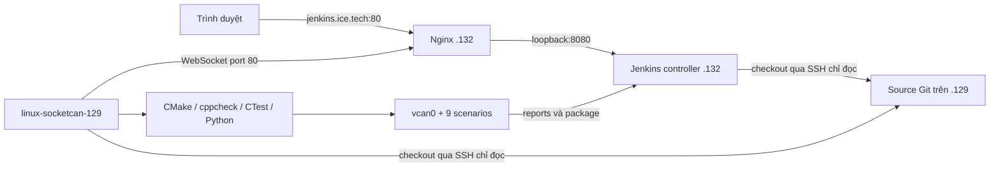

# Jenkins controller và agent riêng

| Máy | Vai trò | User dịch vụ | Executor |
| --- | --- | --- | --- |
| 192.168.222.132 | Jenkins controller, credentials, history, artifacts, Nginx | jenkins | 0 |
| 192.168.222.129 | Source repository, build/test SocketCAN trên vcan0 | jenkins-agent | 1 |



Agent chủ động kết nối controller bằng WebSocket; controller không SSH để
khởi chạy agent. SSH ở đây dùng để checkout source. Hai user dịch vụ riêng
không có quyền sudo. Chỉ service provision vcan cần root.

## Truy cập

Trên máy dùng trình duyệt, hosts phải chứa:

```text
192.168.222.132 jenkins.ice.tech
```

Mở `http://jenkins.ice.tech`, username/password Jenkins được giữ nguyên sau
migration. Nếu cần lấy lại mật khẩu admin do lab tạo, SSH vào `.132` rồi chạy:

```bash
sudo cat /var/lib/jenkins/admin-password
```

Đường dẫn đó chứa mật khẩu đã tạo ban đầu; nếu tự đổi mật khẩu trên UI thì
dùng mật khẩu mới. Không gửi mật khẩu hoặc agent secret vào logs/Git.

## Controller .132

- Jenkins home: `/var/lib/jenkins`.
- Runtime: `/opt/adas-jenkins/jenkins.war` (Jenkins 2.580.2).
- Service: `adas-jenkins.service`, dùng template
  `scripts/systemd/adas-jenkins-controller.service`.
- Nginx site: `/etc/nginx/sites-available/jenkins.ice.tech`.
- Built-in executors = 0, inbound TCP agent port tắt; WebSocket dùng port 80.
- Snapshot trước migration: `/var/backups/adas-jenkins/pre-migration.tar.gz`,
  chỉ root đọc. Snapshot có dữ liệu nhạy cảm phục vụ rollback, không đưa vào Git.

Jobs, credentials, encryption keys, users, build history và artifacts được
chuyển cùng Jenkins home sau khi controller cũ dừng. Không chạy bootstrap tạo
lại security realm vì sẽ thay tài khoản người dùng đã có.

Job `adas-validation` vẫn theo `*/main`. Source đang dùng URL
`ssh://ice@192.168.222.129/home/ice/projects/adas-integration-lab`, credential
`adas-source-readonly`. Khóa riêng của credential được Jenkins lưu mã hóa;
authorized_keys trên source buộc chạy `git-upload-pack` cho đúng repo, không
cấp shell hay push. Host key được pin trên cả controller và agent.

Đây vẫn là source Git local của đồ án, chưa chuyển sang GitHub/GitLab remote.
Sau khi push source, có thể đổi URL và credential trong Configure của job.
Job failure demo lịch sử được giữ lại nhưng disabled vì fixture tạm trên
controller cũ không phải nguồn SCM cần vận hành thường xuyên.

## Agent .129

- Node name: `linux-socketcan-129`, label: `linux-socketcan`.
- Work directory: `/var/lib/adas-jenkins-agent`.
- Service: `adas-jenkins-agent.service`.
- Secret: `/var/lib/adas-jenkins-agent/secret`, quyền 0600; lệnh Java dùng
  `-secret @file` để không đưa secret vào danh sách process.
- vcan0 do `adas-vcan.service` provision trước khi agent chạy.
- Pipeline dùng workspace riêng; không build trực tiếp trong source checkout
  của user ice. Artifact được chuyển về controller qua Jenkins.

```bash
systemctl status adas-jenkins-agent.service
journalctl -u adas-jenkins-agent.service -n 50 --no-pager
ip -details link show vcan0
```

Trên controller:

```bash
systemctl status adas-jenkins.service nginx
journalctl -u adas-jenkins.service -n 50 --no-pager
```

Các services đã enabled để khởi động sau reboot; chưa tự reboot máy trong
phiên migration. Đã restart controller sau khi xóa bootstrap/staging và kiểm
chứng agent tự reconnect qua WebSocket, built-in vẫn giữ 0 executor.
Theo [hướng dẫn Jenkins](https://www.jenkins.io/doc/book/security/controller-isolation/),
build được chuyển khỏi built-in node. Giao thức agent theo
[Jenkins Remoting](https://github.com/jenkinsci/remoting/blob/master/docs/inbound-agent.md).
